<p align="center">
  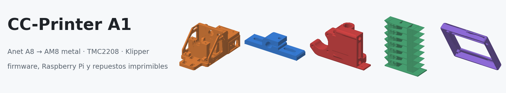
</p>

<p align="center">
  
  
  
  
  
  
  
</p>

Este repo documenta una **Anet A8 convertida a marco metálico AM8** que hoy imprime con **Klipper**
sobre una Raspberry Pi 4, sin dejar de lado la parte de Marlin. Incluye:
- el firmware con todo su historial y un `.hex` para volver atrás si hace falta;
- la configuración completa del host (Klipper, Moonraker, Fluidd, nginx, la cámara y el túnel);
- **71 piezas imprimibles** con vista previa (68 repuestos y 3 de calibración);
- **G-codes de calibración generados por script**;
- lo que aprendimos rompiendo cosas.

> Si tenés una A8, una AM8 o cualquier impresora con RAMPS, acá hay configuraciones, números y
> scripts para copiar. Cada sección enlaza a los archivos reales.

**Contenido** · [La máquina](#️-la-máquina) · [Arquitectura](#-arquitectura) · [Mapa del repo](#️-mapa-del-repo) ·
[Firmware](#-firmware) · [Raspberry Pi](#-raspberry-pi) · [Piezas imprimibles](#-piezas-imprimibles) ·
[Calibración](#-calibración) · [Scripts](#️-scripts) · [Lecciones aprendidas](#-lecciones-aprendidas) ·
[Estado y próximos pasos](#-estado-y-próximos-pasos) · [Créditos](#-licencias-y-créditos)

---

## 🖨️ La máquina

| | Componente | Detalle |
|---|---|---|
| 🏗️ | **Marco** | AM8HD: marco metálico tipo Prusa sobre la base de una Anet A8 |
| 🧠 | **Placa** | Arduino Mega 2560 (clon CH340) + RAMPS 1.5 |
| ⚙️ | **Drivers** | X/Y/Z **TMC2208** standalone (1/16, StealthChop) · E **A4988** (1/16) |
| 🔄 | **Motores** | 4 × NEMA 17 **0,9°** (17HA40001H-22B); los dos de Z en paralelo en un driver |
| 🔗 | **Transmisión** | Correa GT2 con polea de 16 dientes (X/Y) · varilla T8 de avance 8 mm (Z) |
| 🔥 | **Hotend** | Estilo E3D V6 con **PTFE interior** (máx. 250 °C), extrusor direct drive |
| 🟥 | **Cama** | 200 × 200 con vidrio de 3 mm, controlada por **MOSFET externo** |
| 🔌 | **Fuente** | 12 V 20 A |
| 🖥️ | **Pantalla** | RepRapDiscount Full Graphic Smart Controller (12864) |
| 🍓 | **Host** | Raspberry Pi 4 B 2 GB + cámara IMX219 NoIR |
| 📦 | **Volumen** | 200 × 200 × 200 mm |

## 🧭 Arquitectura

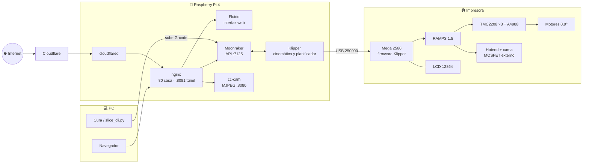

La Pi calcula todos los movimientos y el Mega solo genera los pulsos. Por eso el AVR de 8 bits deja
de ser un límite. Desde la red de casa Fluidd entra directo; desde internet, por el túnel de
Cloudflare, **siempre pide usuario**, y la cámara solo se ve con una ruta secreta. Los detalles están en
[`raspberry/README.md`](raspberry/README.md).

## 🗂️ Mapa del repo

```text
📦 cc-printer
├── 🔧 Marlin/              Configuration.h y Configuration_adv.h de esta máquina (Marlin 2.1.2)
├── 💾 firmware-builds/     un .hex por versión + las configs y el log con que se compiló
├── 🗄️ config-backups/      configs originales de 2023 y una copia antes de cada cambio
├── 🍓 raspberry/           todo el host: Klipper, Moonraker, nginx, cámara, systemd + guía de rearmado
├── 📐 calibracion/         G-codes y STL de calibración + generadores en Python (_gen/)
├── ✂️ gcode/               G-codes listos + slicer por línea de comandos (_slicer/)
├── 🧊 stl-repuestos/       piezas de repuesto imprimibles, ordenadas por zona de la máquina
├── 🍰 cura/                definición de máquina y extrusor para Cura
├── 🖼️ assets/              imágenes de este README + su generador
└── 📚 docs/ buildroot/ ini/ …   Marlin original sin cambios (README de Marlin en docs/Marlin-README.md)
```

## 🧠 Firmware

### Klipper (el actual)

La configuración está en [`raspberry/klipper/printer.cfg`](raspberry/klipper/printer.cfg) y las macros
(`CANCEL_PRINT`, `PAUSE`, `RESUME`, `M300`) en [`macros.cfg`](raspberry/klipper/macros.cfg).
El firmware del Mega se compila con [`mcu-atmega2560.config`](raspberry/klipper/mcu-atmega2560.config):
atmega2560, 16 MHz, 250000 baudios.

| Parámetro | Valor | De dónde sale |
|---|---|---|
| `rotation_distance` X / Y | **31.892** | 200,68 pasos/mm medidos (400 × 16 / 200,68) |
| `rotation_distance` Z | **8** | varilla T8 de avance 8 mm (= 800 pasos/mm) |
| `rotation_distance` E | **36.353** | 176,05 pasos/mm verificados extruyendo 100 mm |
| `full_steps_per_rotation` · `microsteps` | **400** · **16** | motores de 0,9° con los jumpers MS1+MS2 |
| `max_velocity` | **60 mm/s** | a 80 mm/s X e Y pierden pasos (ver [lecciones](#-lecciones-aprendidas)) |
| `max_accel` · `square_corner_velocity` | 3000 · 5 | heredados de Marlin |
| Input shaper X/Y | ZV 40 Hz | provisorio, falta medirlo con el ADXL345 |
| PID hotend (200 °C, ventilador 100 %) | 22.172 / 1.369 / 89.796 | `PID_CALIBRATE`, guardado con `SAVE_CONFIG` |
| PID cama (60 °C) | 58.693 / 1.168 / 737.329 | `PID_CALIBRATE` |
| Temperatura máxima | hotend 250 °C · cama 130 °C | el PTFE del hotend no aguanta más |
| `[bed_screws]` | esquinas a 30 mm del borde | nivelación manual: `BED_SCREWS_ADJUST` |

> [!TIP]
> **¿Por qué 31,892 y no 32?** En teoría, polea de 16 dientes × 2 mm = 32 mm por vuelta.
> A 400 × 16 = 6400 micropasos por vuelta eso da 200 pasos/mm. La medición real dio 200,68
> (un 0,34 % más), y 6400 / 200,68 = 31,892.

### Marlin 2.1.2 (historial y rollback)

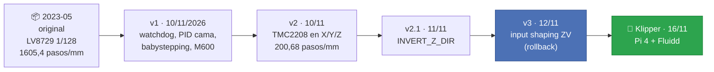

| Versión | Qué cambió | Flash | RAM | Carpeta |
|---|---|---|---|---|
| original (2023) | LV8729 a 1/128 en X/Y. El AVR no pasaba de ~41 mm/s | — | — | [`config-backups/2023-05-27-original`](config-backups/2023-05-27-original) |
| **v1** | máx. 260 °C, PID de cama, `LCD_BED_TRAMMING`, babystepping, pausa/cambio de filamento (M600/M701/M702), `EMERGENCY_PARSER`, watchdog | 52,2 % | 58,3 % | [`2026-11-10-v1`](firmware-builds/2026-11-10-v1) |
| **v2** | TMC2208 standalone en X/Y/Z, 200,68 pasos/mm | 52,2 % | 58,3 % | [`2026-11-10-v2`](firmware-builds/2026-11-10-v2) |
| **v2.1** | `INVERT_Z_DIR` (los TMC invierten DIR respecto del A4988) | 52,2 % | 58,3 % | [`2026-11-11-v2.1`](firmware-builds/2026-11-11-v2.1) |
| **v3** | input shaping ZV en X/Y (`M593`, experimental en AVR) | 54,6 % | 70,0 % | [`2026-11-12-v3`](firmware-builds/2026-11-12-v3) |

<details>
<summary><b>Compilar Marlin o volver a él</b></summary>

```bash
# Compilar (PlatformIO; env por defecto: mega2560)
pio run                                  # -> .pio/build/mega2560/firmware.hex

# Volver a Marlin desde Klipper: parar Klipper y flashear el v3 archivado
sudo systemctl stop klipper
avrdude -p atmega2560 -c wiring -b 115200 -D -P /dev/ttyUSB0 \
        -U flash:w:firmware-builds/2026-11-12-v3/firmware-v3.hex:i
```

- Los `.hex` están marcados como binarios en `.gitattributes`, así que se bajan byte por byte iguales.
- Si VS Code (PlatformIO / Auto Build Marlin) te reindexa el proyecto en medio de la compilación,
  compilá con `PLATFORMIO_BUILD_DIR` y `PLATFORMIO_LIBDEPS_DIR` apuntando a una carpeta fuera del proyecto.
- Los ajustes de la EEPROM antes del cambio a Klipper (`M503`) están en
  [`raspberry/klipper/marlin_backup_M503_2026-11-16.txt`](raspberry/klipper/marlin_backup_M503_2026-11-16.txt).
</details>

## 🍓 Raspberry Pi

| Servicio | Qué hace | Config en el repo |
|---|---|---|
| **klipper** | firmware del lado del host: cinemática, planificador, macros | [`klipper/`](raspberry/klipper) · [`klipper.service`](raspberry/systemd/klipper.service) |
| **moonraker** | API web de Klipper, archivos, historial, usuarios | [`moonraker.conf`](raspberry/moonraker/moonraker.conf) |
| **Fluidd** | interfaz web (v1.38.0), con login para entrar desde afuera | se baja del release oficial |
| **nginx** | `:80` red de casa · `127.0.0.1:8081` túnel con IP real y login | [`nginx/`](raspberry/nginx) |
| **cc-cam** | cámara IMX219 NoIR → MJPEG con Picamera2 (tuning NoIR, sin él sale magenta) | [`cc-cam/`](raspberry/cc-cam) |
| **cloudflared** | túnel de Cloudflare, sin abrir puertos en el router | [`cloudflared-impresora.service`](raspberry/systemd/cloudflared-impresora.service) |

📘 **Rearmado desde cero, paso a paso:** [`raspberry/README.md`](raspberry/README.md).

<p align="center">
  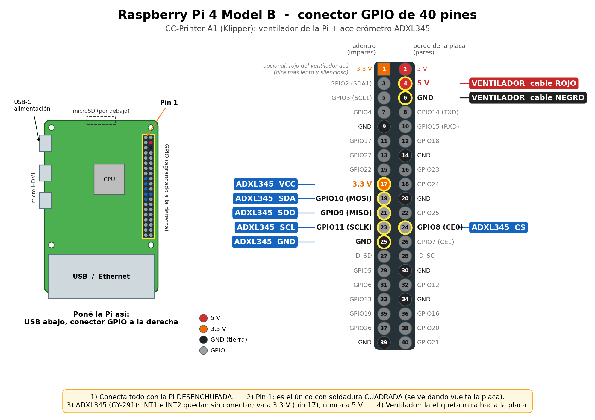
  <br><sub>Hoja de pines (<a href="raspberry/pinout_pi4_ccpa1.pdf">PDF A4</a>): ventilador de la Pi y acelerómetro ADXL345 por SPI.</sub>
</p>

> [!IMPORTANT]
> En el repo **no hay ninguna clave**. La contraseña de la Pi, el token del túnel, la clave del Wi-Fi
> y la ruta secreta de la cámara quedan fuera de git (`.secrets` está en `.gitignore`).
> En `moonraker.conf` la cámara figura como `cam-SECRETO`; la ruta real la genera
> [`rotar_link_camara.sh`](raspberry/cc-cam/rotar_link_camara.sh).

## 🧊 Piezas imprimibles

[`stl-repuestos/`](stl-repuestos) tiene los repuestos de la máquina, ordenados por zona. Las vistas
se generan con [`assets/_gen/gen_galeria_stl.py`](assets/_gen/gen_galeria_stl.py) e indican la medida
de cada pieza en mm.

<details open>
<summary><b>03 · Carro del hotend E3D</b> (5 piezas): soporte direct drive, abrazadera, ducto, porta-cables</summary>

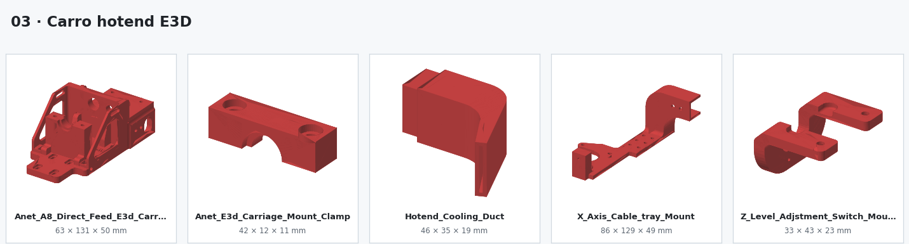

- ⚠️ **`Anet_E3d_Carriage_Mount_Clamp`**: la ranura mide Ø11,9 × 6,0 mm, con ajuste justo para un V6
  original. Si el hotend tiene juego, aparece ghosting: 0,1 mm de juego se convierte en ~0,4 mm en la punta.
  Lijar 0,2–0,3 mm la cara plana hace que la abrazadera apriete.
</details>

<details>
<summary><b>01 · Marco AM8HD, ejes Y y Z</b> (21 piezas): tensores, finales de carrera, soportes de Z, patas</summary>

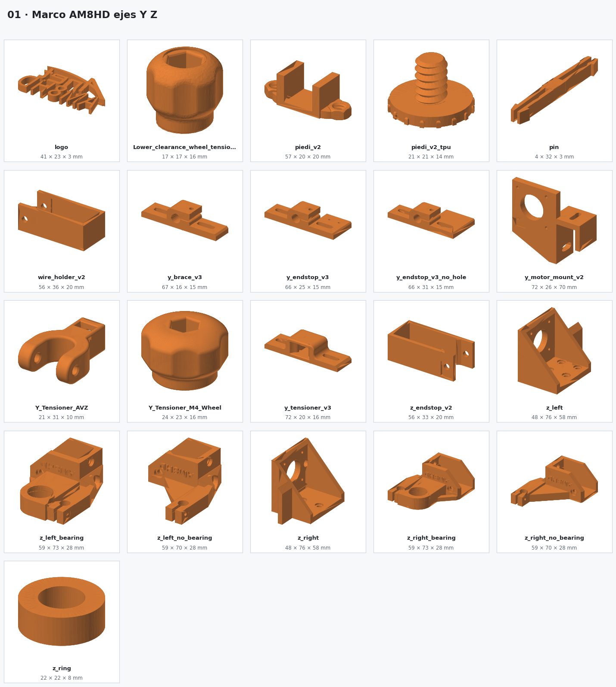

- ⚠️ **`y_brace_v3`**: imprimirla **de costado** (`rotx=90`). Acostada, la mordaza superior queda
  flotando sobre una ranura de 1 mm y la ranura se cierra. El G-code listo, ×4 de costado, es
  [`gcode/CCPA1_YBraceCostado_x4.gcode`](gcode/CCPA1_YBraceCostado_x4.gcode).
- `piedi_v2_tpu`: pata para imprimir en TPU (absorbe vibraciones).
</details>

<details>
<summary><b>02 · Soportes del eje X (AM8)</b> (2 piezas): lado motor y lado polea</summary>

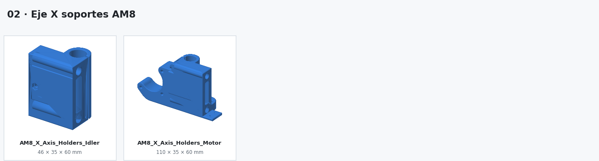
</details>

<details>
<summary><b>04 · Cadenas portacables</b> (15 piezas): 3 modelos + soportes para el eje Y de la A8</summary>

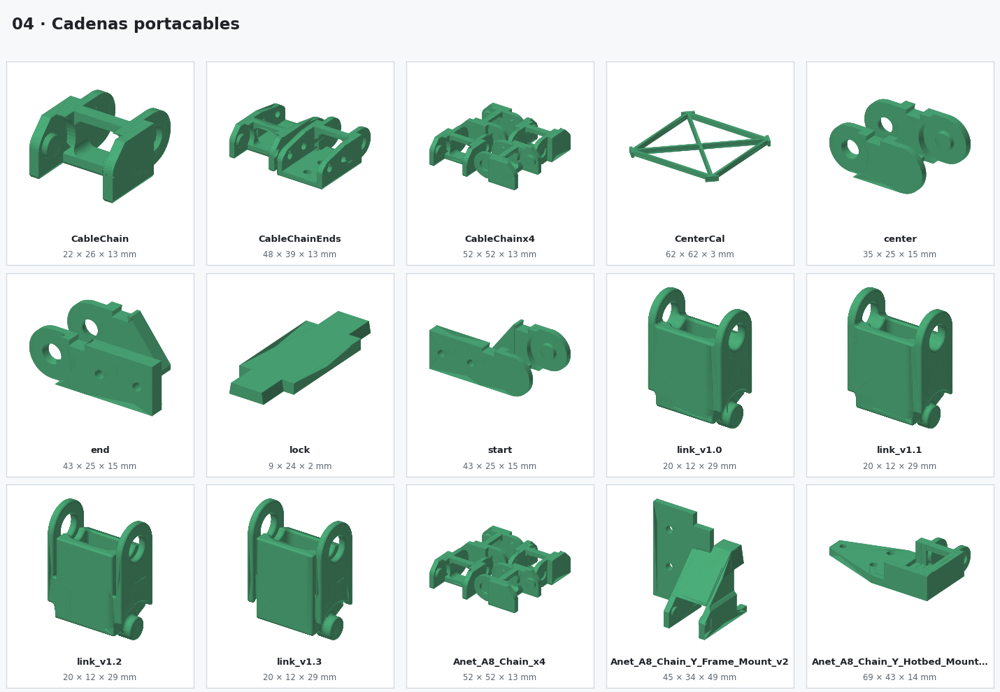

Modelos de Thingiverse: [thing:11978](https://www.thingiverse.com/thing:11978) ·
[thing:1760952](https://www.thingiverse.com/thing:1760952) · [thing:666118](https://www.thingiverse.com/thing:666118)
</details>

<details>
<summary><b>05 · Electrónica y pantalla</b> (15 piezas): caja del MOSFET, caja LCD 12864, soportes de RAMPS y fuente</summary>

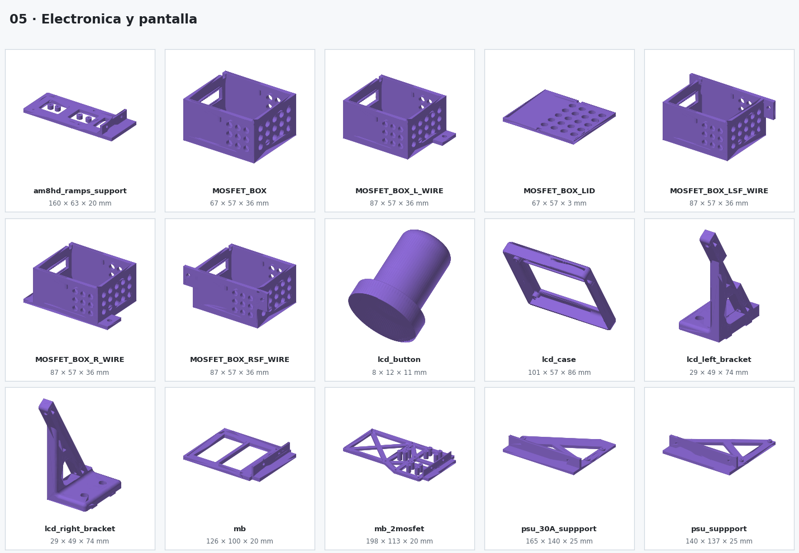
</details>

<details>
<summary><b>06 · Portabobina y cama</b> (5 piezas): portabobinas de la A8, bloque de rodamiento IGUS</summary>

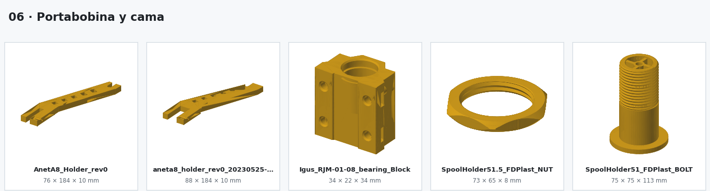
</details>

<details>
<summary><b>07 · Calibración (modelos de terceros)</b> (5 piezas): cubo XYZ, test de nivelación, cruz de centro</summary>

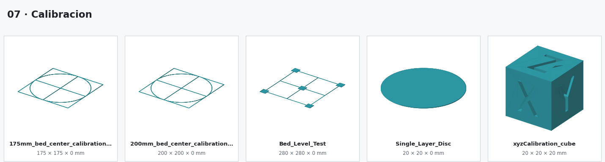

El **cubo XYZ** sirve para leer el ghosting por eje: la cara de la "X" la imprime el eje X.
</details>

## 📐 Calibración

Este es el orden que usamos. Cada paso supone que el anterior ya está bien.

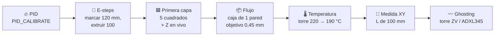

Los G-codes de [`calibracion/`](calibracion) se **generan por script**, no salen de un STL de internet.
Así cada geometría mide una sola cosa y no depende de cómo la corte el slicer.

| Archivo | Qué mide | Cómo se lee |
|---|---|---|
| [`CCPA1_PrimeraCapa_200`](calibracion/CCPA1_PrimeraCapa_200.gcode) | altura de la primera capa | 5 cuadrados de 1 capa (centro + esquinas); ajustar en vivo con `SET_GCODE_OFFSET Z_ADJUST=…` |
| [`CCPA1_Flujo`](calibracion/CCPA1_Flujo.gcode) / [`_190`](calibracion/CCPA1_Flujo_190.gcode) | flujo | caja en modo vaso, sin costura. Con el flujo bien, la pared mide **0,45 mm**. Flujo de Cura = 100 × 0,081416 / ((w − 0,2)·0,2 + π·0,01) |
| [`CCPA1_TorreTemp_220-190`](calibracion/CCPA1_TorreTemp_220-190.gcode) | temperatura | 7 bloques (−5 °C cada uno) con el número en relieve, puente de 14 mm y voladizos de 45° y 55° |
| [`CCPA1_MedidaXY_190`](calibracion/CCPA1_MedidaXY_190.gcode) | pasos/mm de X e Y | L de bloques separados 100 mm. Medir A (exterior) y B (hueco): D = (A + B) / 2 y pasos nuevos = actuales × 100 / D. El error de ancho de línea se cancela |
| [`TORREGHO`](calibracion/TORREGHO.gcode) (Marlin) / [`TorreGhosting_Klipper`](calibracion/CCPA1_TorreGhosting_Klipper.gcode) | ringing / input shaping | caja hueca con bandas de 5 mm: sin shaper a 20 y 40 mm/s, después ZV de 20 a 65 Hz |
| [`CCPA1_LegoCubo_190`](calibracion/CCPA1_LegoCubo_190.gcode) / [`_200`](calibracion/CCPA1_LegoCubo_200.gcode) | prueba general | [cubo LEGO](https://www.thingiverse.com/thing:4645349) a 190 y 200 °C para comparar |

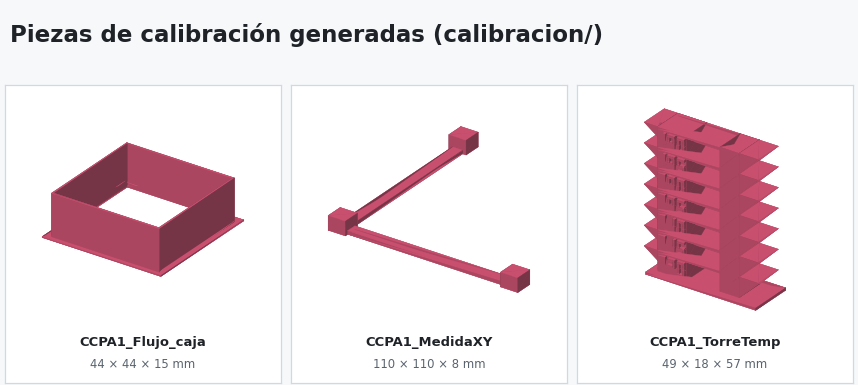

> [!NOTE]
> **Resultado de la torre de temperatura:** a 190 °C es donde mejor se ve, pero el cubo a 190 °C
> pegó peor las capas que a 200 °C. Para piezas de uso, **200 °C**; 190 °C solo para piezas estéticas.

## 🛠️ Scripts

| Script | Para qué | Uso |
|---|---|---|
| [`calibracion/_gen/gen_first_layer.py`](calibracion/_gen/gen_first_layer.py) | prueba de primera capa | `gen_first_layer.py out.gcode [T_hotend] [T_cama]` |
| [`calibracion/_gen/gen_flow_box.py`](calibracion/_gen/gen_flow_box.py) | caja de flujo en modo vaso | `gen_flow_box.py out.gcode [T]` |
| [`calibracion/_gen/gen_temp_tower.py`](calibracion/_gen/gen_temp_tower.py) | torre de temperatura (STL + G-code) | `gen_temp_tower.py` |
| [`calibracion/_gen/gen_xy_dim.py`](calibracion/_gen/gen_xy_dim.py) | L de medida X/Y | `gen_xy_dim.py [T]` |
| [`gcode/_slicer/slice_cli.py`](gcode/_slicer/slice_cli.py) | **cortar sin abrir Cura**: CuraEngine con los perfiles de Cura ya resueltos | `slice_cli.py pieza.stl out.gcode 4 base=resistente rotx=90 hotend=210` |
| [`raspberry/_gen/gen_pinout.py`](raspberry/_gen/gen_pinout.py) | hoja de pines de la Pi (PNG + PDF) | `gen_pinout.py raspberry/pinout_pi4_ccpa1` |
| [`raspberry/cc-cam/rotar_link_camara.sh`](raspberry/cc-cam/rotar_link_camara.sh) | cambia la ruta secreta de la cámara | `sudo ~/cc-cam/rotar_link_camara.sh` |
| [`assets/_gen/gen_galeria_stl.py`](assets/_gen/gen_galeria_stl.py) | las galerías de este README (numpy + matplotlib, sin OpenGL) | `python3 assets/_gen/gen_galeria_stl.py` |

<details>
<summary><b>Más sobre <code>slice_cli.py</code></b></summary>

- Usa `/usr/bin/CuraEngine` (Cura 5.0) con todos los ajustes que la interfaz de Cura había resuelto.
  Están guardados en [`base_diario_1640.args`](gcode/_slicer/base_diario_1640.args) y
  [`base_resistente_0321.args`](gcode/_slicer/base_resistente_0321.args).
- Perfiles:
  - **Diario 0.2**: 2 paredes, cubic al 20 %, 200 °C, ventilador al 100 %, todo a ≤ 60 mm/s.
  - **Resistente**: 5 paredes, gyroid al 50 %, 210 °C, ventilador al 50 %.
- `N` copias se apilan en Y, centradas en la cama. `k=v` cambia cualquier ajuste de Cura.
- ⚠️ CuraEngine por línea de comandos **no recalcula los ajustes derivados** ni avisa de islas flotantes:
  revisá la pieza antes de cortar.
</details>

La definición de la máquina para Cura está en [`cura/cc_printer_a1.def.json`](cura/cc_printer_a1.def.json)
y la del extrusor en [`cc_printer_a1_extruder_0.def.json`](cura/cc_printer_a1_extruder_0.def.json).

## 💡 Lecciones aprendidas

| | Síntoma | Causa | Solución |
|---|---|---|---|
| ⚡ | Pantalla en blanco y la línea de 5 V a **8,7 V** | al medir Vref con la impresora encendida, la punta resbaló entre los pines de potencia del driver; terminó con el regulador de 5 V del Mega dañado | medir con la punta aislada o una pinza fija en el potenciómetro; o mejor, drivers por UART, que no necesitan Vref |
| 🧀 | Cubo "derretido", **200 % de extrusión** | al cambiar la RAMPS se copiaron los jumpers de los TMC al A4988: con MS1+MS2 queda en 1/8 | TMC2208 a 1/16 = MS1+MS2 · A4988 a 1/16 = **los 3**. Al poner en marcha, medir **cuánto** extruye, no solo para qué lado |
| 👻 | Mucho ghosting tras cambiar los drivers | **el hotend tenía juego en la abrazadera** (no eran los drivers ni la correa) | ajustar la abrazadera. La torre de ghosting salió limpia: "nunca imprimió tan bien" |
| 🐌 | X e Y pierden pasos a **80 mm/s** | TMC2208 standalone = StealthChop fijo + 12 V + motores de 0,9° (la fuerza contraelectromotriz crece rápido) | tope de 60 mm/s. Para ir más rápido: TMC por UART (SpreadCycle) o 24 V |
| 🔊 | Ruido tipo "matriz de puntos" entre 24 y 30 mm/s | resonancia de los LV8729 | los TMC2208 lo eliminan: "tremendamente silencioso" |
| 🧮 | Marlin no pasaba de ~41 mm/s | 1605 pasos/mm (1/128) saturan el AVR de 16 MHz | 1/16 → 200,68 pasos/mm; o Klipper, que calcula todo en la Pi |
| 🔌 | Se cortan impresiones desde la SD al abrir Cura | el plugin USBPrinting de Cura abre el puerto, y eso **resetea el Mega** | desactivar *USB printing* en Cura (o `plugins.json`) |
| 🌡️ | Pi a 78 °C en 2 minutos de carga | gabinete cerrado sin ventilador | con ventilador (pines 4 y 6) se estabiliza en ~62 °C |
| 💾 | Se pierde el PID después de editar `printer.cfg` | `SAVE_CONFIG` escribe el bloque `#*#` **en la Pi** | traer el `printer.cfg` de la Pi antes de pisarlo con la copia del repo |

## ✅ Estado y próximos pasos

- [x] Drivers TMC2208: ruido resuelto
- [x] Ghosting resuelto (abrazadera del hotend)
- [x] Klipper + Moonraker + Fluidd en la Pi 4, con cámara y acceso remoto con login
- [x] PID, dirección de los ejes, finales de carrera y extrusión verificados en Klipper
- [ ] **ADXL345**: medir la resonancia real y reemplazar el ZV de 40 Hz provisorio
- [ ] **BLTouch**: malla de la cama
- [ ] Pressure advance (torre)
- [ ] Corriente de los TMC por UART (SpreadCycle) o fuente de 24 V para pasar de 60 mm/s

## 📜 Licencias y créditos

- **Marlin 2.1.2**: [MarlinFirmware/Marlin](https://github.com/MarlinFirmware/Marlin), GPL-3.0 ([`LICENSE`](LICENSE)).
  El README original está en [`docs/Marlin-README.md`](docs/Marlin-README.md).
- **Klipper**, **Moonraker** y **Fluidd** (GPL-3.0) no están incluidos: se instalan desde sus repos oficiales
  ([Klipper3d/klipper](https://github.com/Klipper3d/klipper), [Arksine/moonraker](https://github.com/Arksine/moonraker),
  [fluidd-core/fluidd](https://github.com/fluidd-core/fluidd)).
- **Las piezas de `stl-repuestos/`** son de sus autores (proyecto AM8 y otros modelos de Thingiverse). Están acá
  como copia de trabajo de esta máquina; antes de redistribuirlas, revisá la licencia original de cada una.
